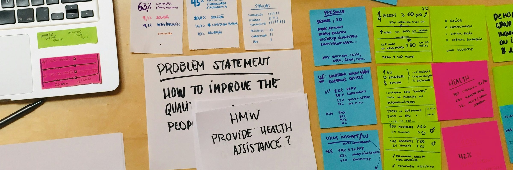
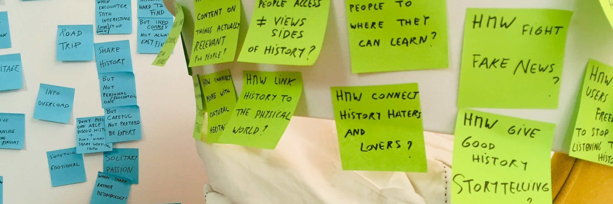
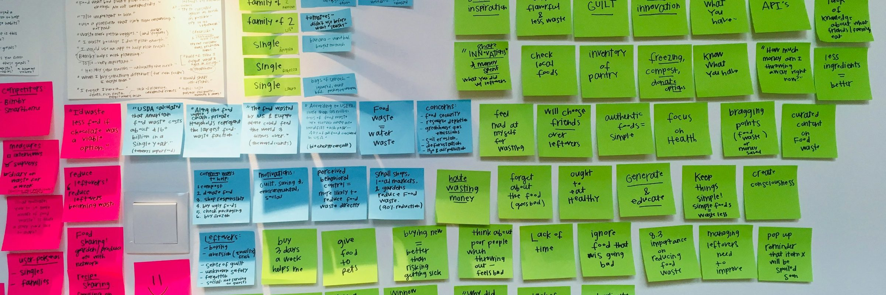

# Courses

An open home on the web for one course or many, each with its own pages, sidebar and navbar, written in plain Markdown files you control.

The three example courses come from [Grav Open Course Space](https://github.com/hibbitts-design/grav-skeleton-open-course-space), published here from the same Markdown files: **CPT363-1** and **CPT363-2** are organised by modules, and **CPT363-3** by weekly units.

To make your own, start from the [Docsify Open Courses Starter Kit](https://github.com/hibbitts-design/docsify-open-courses-starter-kit) on GitHub.

## [CPT363-1](cpt363-basic/home.md)

This is a basic example course, organised by modules, using only a small number of page types and features.

## [CPT363-2](cpt363-intermediate/home.md)

This is an intermediate example course, organised by modules, using a moderate number of page types and features.

## [CPT363-3](cpt363-advanced/home.md)

This is an advanced example course, organised by weekly units, using a large number of page types and features.

<!-- Hides the sidebar on this page -->

